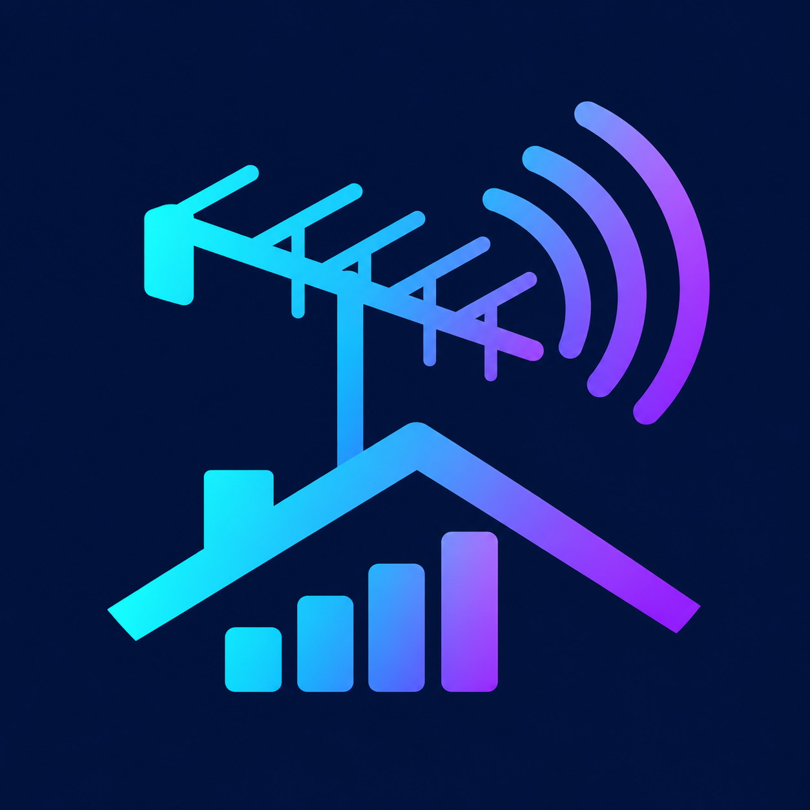

<p align="center"></p>

# HDHomeRun Signal Monitor

Live antenna reception readings inside Jellyfin 12.2. Watch each tuner's channel, signal strength, signal quality, and symbol quality update automatically, with a rolling graph to help adjust your antenna.

## Installation

Add this repository URL under **Dashboard → Plugins → Repositories**:

```text
https://raw.githubusercontent.com/aober420/HDHomeRun-Signal-Monitor/main/manifest.json
```

Install **HDHomeRun Signal Monitor** and restart Jellyfin. Open **HDHomeRun Signal Monitor** from the dashboard sidebar under **Plugins** (antenna icon), or from its plugin settings. Play a channel to see its reception; idle tuners have no signal readings.

The monitor uses HDHomeRun tuners already configured under Live TV. Additional addresses can be entered on its settings page. It reads status only and does not change channels. No account or subscription is required.

**1.0.0** · Requires Jellyfin 12.2. Monitoring pauses when the browser tab is hidden and stops when you leave the page.


